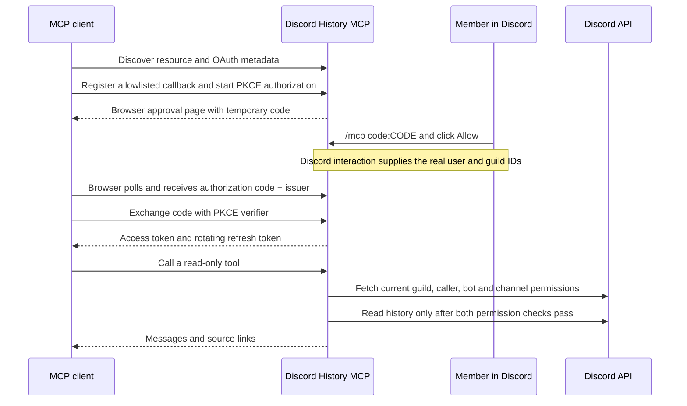

# Architecture

One Python service runs an MCP HTTP server, an OAuth authorization server, and a Discord Gateway client for slash-command approval. History reads use a separate HTTP client restricted to Discord REST GET requests. Gateway operations register the dedicated app’s `/mcp` command and send private interaction replies.

## Authorization boundaries

- The client cannot choose `user_id` or `guild_id` in an MCP call. They come from a grant established by the Discord interaction.
- A 256-bit browser flow ID and 48-bit temporary approval code are distinct from the OAuth authorization code. The temporary code alone does not authorize access; a member must approve it in Discord.
- Consent buttons verify both the caller and guild, even when called outside the normal UI dispatcher. Consent is one-time; simultaneous approvals cannot overwrite each other.
- OAuth codes are one-use, expire after two minutes and are bound to client, callback, PKCE challenge, resource and approved identity. Issuer identification follows RFC 9207, including authorization error redirects.
- Access tokens expire after one hour. Rotating refresh tokens share a grant’s fixed 30-day expiry; refreshing does not extend it. Grants belong to one guild. Revocation deletes associated tokens, unexchanged codes and approved pending requests.
- Membership, guild roles and channel overrides are refreshed on each read. Unknown or inconsistent data fails closed. No message cache or local history mirror exists.
- Permission checks and a subsequent Discord API read are separate requests. A role change during an in-flight request can race that read; the next call rechecks current state. Data already delivered cannot be recalled.

## Storage and availability

SQLite stores client registration metadata (including client secrets), grants, token hashes and temporary authorization state. The database is mode 600 inside a mode-700 directory. Back it up as a secret. Losing it revokes all existing connections.

Unused registrations expire after 24 hours; the oldest unused registration can be evicted when the 1,000-client cap is reached. A registration referenced by a pending flow, code or active grant is protected. Expired flow/token state is pruned during registration and client lookup. Sustained hostile traffic can still deny service.

This is a single-process deployment. SQLite, Discord command ownership and in-memory quotas are not designed for multiple replicas. Do not run several instances with the same bot token or shared state directory.
